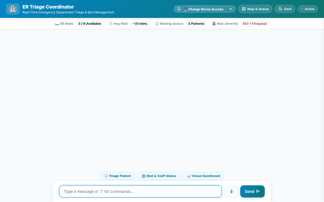

# 🏥 ER Triage Coordinator

An intelligent, multi-tool conversational AI agent built with the **Google Agent Development Kit (ADK)** to assist emergency department charge nurses, triage officers, and hospital coordinators. The system streamlines arriving patient intake, calculates Emergency Severity Index (ESI) priority levels, manages real-time bed inventory in Firestore, generates visual floorplan & wait time dashboards, and highlights allergy warnings using ADK Memory Bank.



---

## 🚀 Key Implemented Capabilities & Wired Tools

The following capabilities and tools are fully implemented in `app/` and configured in `agents-cli-manifest.yaml`:

### 🤖 Core Agent Architecture
* **Google Agent Development Kit (ADK)**: Built using `google.adk.agents.Agent` powered by the `gemini-flash-latest` model.
* **Agent Engine Sandbox Execution**: Integrated with `AgentEngineSandboxCodeExecutor` to safely execute Python code in an isolated Cloud Run / Reasoning Engine sandbox for complex wait-time math and queue analytics.

### 🧠 Persistent Memory Bank
* **ADK Memory Bank Integration**: Preloaded via `PreloadMemoryTool()` and automatically saves session memories via `CallbackContext.add_session_to_memory`. Automatically recalls user/patient allergy history (medications, latex, iodine) and shift notes across multi-turn sessions.

### 🗄️ Google Cloud Firestore Real-Time State Management
* **`get_bed_status(department)`**: Queries live ER bed availability, cleaning status, and occupied units from the `er_beds` collection.
* **`update_bed_status(bed_id, status, patient_id, assigned_staff)`**: Updates bed allocation states in Firestore.
* **`get_patient_queue(status)`**: Fetches active waiting patients and triage priority levels from the `patient_queue` collection.
* **`add_patient_to_queue(patient_name, chief_complaint, esi_level)`**: Adds newly triaged patients to the Firestore queue.
* **`calculate_department_wait_times(department)`**: Calculates live queue length, bed occupancy ratios, and estimated departmental wait times.

### 🎨 Vertex AI GenAI Image & Video Generation
* **`generate_er_floorplan_image(prompt)`**: Uses Vertex AI GenAI (`gemini-3.1-flash-lite-image` in `global` region) to generate visual ER floorplan layout diagrams and heatmaps.
* **`generate_departmental_wait_times_dashboard_image(prompt)`**: Uses `gemini-3.1-flash-lite-image` to generate visual real-time departmental wait times infographic dashboards.
* **`generate_triage_instruction_video(prompt)`**: Uses Google's Omni model (`gemini-omni-flash-preview` in `global` region) to generate short instructional video clips for triage procedures.
* **Google Cloud Storage (GCS)**: Uploads generated image and video bytes directly to public GCS buckets, serving public HTTPS URLs for inline rendering in the frontend.

### 🎛️ A2UI Rich Component Catalog & Frontend
* **A2UI v0.8 Schema Integration**: Uses `A2uiSchemaManager` and `BasicCatalog` to stream structured Card, Column, Row, Text, Image, and Icon components.
* **Interactive Frontend**: Features customized role access modes (Charge Nurse, Triage Officer, ER Director, Paramedic/EMS), unit filter pills (`Trauma Only`, `Cardiac Care`, `All Beds`), and interactive SVG department load widgets.

### 💊 FDA Drug Safety Tool
* **`get_drug_safety_info(drug_name)`**: Queries the OpenFDA API for real-time drug warnings, contraindications, and clinical trial adverse effects.

---

## 📋 Planned Capabilities (Not Yet Implemented)

The following items mentioned in preliminary design briefs are planned for future iterations and are **not yet implemented**:
* ⚠️ **Cloud Trace Latency Tracking**: Distributed tracing for multi-tool latency profiling (*Planned, not yet implemented*).
* ⚠️ **Automated SMS/Email Emergency Alerts**: Pager/SMS notification triggers for mass casualty events (*Planned, not yet implemented*).

---

## 🛠️ Local Development & Setup Instructions

### Prerequisites
* Python 3.11+
* Node.js 18+
* Google Cloud SDK (`gcloud`) authenticated with a GCP project containing Firestore and Vertex AI APIs enabled.

### 1. Repository Setup
```bash
# Clone repository and enter directory
git clone https://github.com/your-org/er-triage-coordinator.git
cd er-triage-coordinator

# Create Python virtual environment
python3 -m venv .venv
source .venv/bin/activate

# Install dependencies
pip install -r frontend/requirements.txt
pip install google-adk google-genai google-cloud-firestore google-cloud-storage
```

### 2. Environment Configuration
Create a `.env` file in the project root:
```env
PROJECT_ID=your-gcp-project-id
LOCATION=us-east1
GCS_BUCKET_NAME=your-gcs-bucket-name
```

### 3. Seed Firestore Database
Populate Firestore with initial ER bed inventory and active patient queue data:
```bash
python seed_data.py
```

### 4. Run Frontend & Agent Locally
Start the FastAPI server hosting the agent chat API and A2UI web interface:
```bash
uvicorn frontend.main:app --host 0.0.0.0 --port 8080 --reload
```
Open a browser and navigate to `http://localhost:8080` (or `http://127.0.0.1:8080`) to interact with the ER Triage Coordinator.
